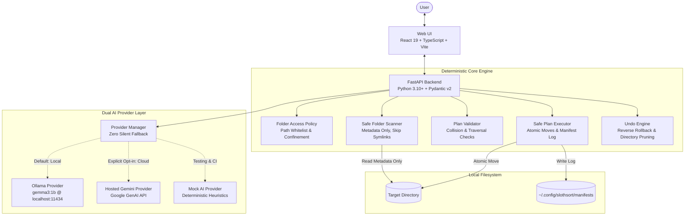

# 🦥 SlothSort

> *"Let your laptop clean up after you."*

SlothSort is an open-source, local-first AI file organizer built for the **Hacktoberfest 2026 Week 3 Open-Source AI Challenge: "Slow and Steady"**. Designed for standard consumer laptops (16 GB RAM, integrated graphics), SlothSort uses open-weight local AI (`gemma3:1b` via Ollama) to analyze file metadata, propose intuitive categories and cleaner filenames, and safely reorganize cluttered folders—all without uploading your personal files to the cloud.

---

## ⚡ 60-Second Quickstart

```bash
# 1. Clone repository
git clone https://github.com/Tanmay-Dalvi/slothsort.git
cd slothsort

# 2. Terminal 1: Backend
cd backend && python3 -m venv .venv && source .venv/bin/activate
pip install -r requirements.txt
uvicorn app.main:app --reload --host 127.0.0.1 --port 8000

# 3. Terminal 2: Frontend
cd frontend && npm install && npm run dev

# 4. Open http://localhost:5173 and click "Load Demo & Scan"
```

---

## 📸 Application Preview

<!-- SCREENSHOT_PLACEHOLDER_START -->
```text
+---------------------------------------------------------------------------------------------------+
| 🦥 SlothSort  [Slow & Steady]  Let your laptop clean up after you.   (● Engine Online) [History: 3] |
+---------------------------------------------------------------------------------------------------+
| [ AI Provider Selection: ● Local Ollama (gemma3:1b) ]  [ Target Folder: /tmp/slothsort_demo ]    |
| [ 🔒 100% Offline & Private — Zero Data Leaves ]       [ [ Scan Folder ] [ Generate Plan ]  ]    |
+---------------------------------------------------------------------------------------------------+
| PROPOSED ORGANIZATION PLAN (11 of 12 approved)                                [ Validate Edits ]  |
| [x] invoice_2026_q3_draft.pdf      ->  Finance/invoice_2026_q3_draft.pdf          [MOVE]  [Edit] |
| [x] meeting_notes_launch.txt       ->  Notes/meeting_notes_launch.txt             [MOVE]  [Edit] |
| [x] backup_runner_nightly.py       ->  Development/backup_runner_nightly.py       [MOVE]  [Edit] |
| [ ] device_firmware_driver_v4.bin  ->  (Unapproved — remains in root untouched)   [KEEP]  [Edit] |
+---------------------------------------------------------------------------------------------------+
| [ Apply Approved Changes (11) ]                                             [ ↩ Undo Last Batch ] |
+---------------------------------------------------------------------------------------------------+
```
> **Note for Contributors & Maintainers:** To capture genuine screenshots, start the app with `npm run dev` and `uvicorn`, navigate to `http://localhost:5173`, load `/tmp/slothsort_demo`, and replace this ASCII block with genuine screenshots in `docs/assets/screenshots/`.
<!-- SCREENSHOT_PLACEHOLDER_END -->

---

## ✨ Key Features

- 🔒 **100% Privacy by Default:** Analyzes only file names, extensions, sizes, and timestamps. Never reads file contents, code, or bytes.
- 🦥 **Local-First Open-Weight Intelligence:** Powered by Ollama and `gemma3:1b` locally. Zero subscription fees, zero cloud lock-in, and full offline operation.
- ☁️ **Dual-Provider Architecture:** Optional Google Gemini API integration when cloud acceleration is desired. Transparent privacy disclosures prevent silent cloud fallbacks.
- 🛡️ **Ironclad Deterministic Safety:**
  - **Zero Auto-Deletion:** SlothSort has no deletion primitives. It only creates folders and moves files.
  - **Zero Silent Overwrites:** Destination collisions and existing files are caught pre-flight before any disk changes occur.
  - **Path Traversal Immune:** Operations are strictly jailed within your selected target directory.
  - **Symlink Protection:** Symlink sources, targets, and roots are skipped and never followed.
- ↩️ **1-Click Instant Undo:** Every batch produces an atomic JSON transaction manifest that can be rolled back with one click, restoring files to their exact previous state.
- 🌿 **Calm & Polished Experience:** Designed with a soothing forest-green palette, responsive desktop layout, and zero gimmicks.

---

## 🛡️ How the Safety Model Works

SlothSort fundamentally rejects autonomous agent execution on local user filesystems:

1. **Advisory AI Only:** Generative AI models have no file system write or move handles. The model only suggests relative paths.
2. **Metadata-Only Processing:** Zero file contents or byte buffers are ever read. Only filename, extension, file size, and modification time are inspected.
3. **Deterministic Validator:** Every proposed move is validated against path containment (`assert_path_contained`), symlink rejection, intra-batch destination collisions, and existing on-disk destination files.
4. **Mandatory Human Approval:** No files move until the user explicitly reviews the diff table and clicks "Apply Approved Changes". Unapproved files remain untouched.
5. **No Deletion Primitives:** The backend contains no file deletion functions.
6. **Transaction Manifest & Rollback:** Every executed batch writes an ordered transaction manifest to `~/.config/slothsort/manifests/`. Rollback reverses moves and safely removes empty category folders.

Read the complete [**Security & Privacy Model**](docs/SECURITY.md) for threat mitigation and invariant details.

---

## 🏗️ System Architecture

SlothSort operates on an **advisory AI, deterministic engine** model:



---

## 💻 Technology Stack

| Layer | Technologies |
| :--- | :--- |
| **Frontend** | React 19, TypeScript, Vite, Tailwind CSS, Lucide Icons |
| **Frontend Testing** | Vitest, React Testing Library, JSDOM |
| **Backend API** | FastAPI, Uvicorn, Pydantic v2, HTTPX |
| **Backend Testing** | Pytest, Pytest-Asyncio |
| **Local AI** | Ollama daemon with Google Gemma 3 1B (`gemma3:1b`) |
| **Cloud AI (Optional)** | Google Gemini API (`gemini-2.5-flash`) |
| **Storage & Logs** | JSON transaction manifests in `~/.config/slothsort/manifests/` |

---

## 📋 Prerequisites

- **Operating System:** Linux (Ubuntu 22.04+ recommended), macOS, or Windows (WSL2)
- **Python:** 3.10+ (tested on Python 3.11, 3.12, and 3.14)
- **Node.js:** 18+ and npm (tested on Node 20, 22, and 24)
- **Ollama (Recommended):** Installed and running locally
  ```bash
  # In a separate terminal:
  ollama pull gemma3:1b
  ollama serve
  ```
  *(Note: If you do not have Ollama installed, you can still run and test the complete application using the built-in **Deterministic Mock Provider**).*

---

## 🚀 Installation & Setup

### 1. Clone the Repository
```bash
git clone https://github.com/Tanmay-Dalvi/slothsort.git
cd slothsort
```

### 2. Environment Configuration
Copy the example environment configuration template:
```bash
cp .env.example .env
```
*(All variables in `.env.example` are pre-configured with safe local defaults).*

---

## 🖥️ Starting the Application

### Terminal 1: Backend Server (FastAPI)
```bash
cd backend

# Create and activate virtual environment
python3 -m venv .venv
source .venv/bin/activate

# Install dependencies
pip install -r requirements.txt
pip install -e ".[dev]"

# Start backend server
uvicorn app.main:app --reload --host 127.0.0.1 --port 8000
```
Interactive OpenAPI documentation will be accessible at: `http://127.0.0.1:8000/docs`

### Terminal 2: Frontend Server (Vite + React)
```bash
cd frontend

# Install dependencies from committed lockfile
npm install

# Start Vite dev server
npm run dev
```
Open your browser at: **`http://localhost:5173`**

---

## 🧪 Safe Demo Walkthrough

SlothSort includes a safe CLI demo seeder that creates 12 realistic, harmless dummy files (invoices, code, media stubs, archives) in `/tmp/slothsort_demo`:

```bash
# Preview what files will be created (without writing to disk):
python -m backend.app.cli.seed_demo --dry-run /tmp/slothsort_demo

# Seed harmless demo files:
python -m backend.app.cli.seed_demo /tmp/slothsort_demo

# (Optional) Seed with an intentional destination collision to test collision warnings:
python -m backend.app.cli.seed_demo --with-collision /tmp/slothsort_demo
```

### Try it in the Web UI:
1. Open `http://localhost:5173` in your browser.
2. In the target folder input, enter `/tmp/slothsort_demo` and click **"Scan Folder"**.
3. Choose **Local Ollama (`gemma3:1b`)** or **Deterministic Mock**.
4. Click **"Generate Plan"**. Review categorized subfolders (`Finance/`, `Notes/`, `Development/`, `Images/`, `Archives/`).
5. Uncheck one file or edit a folder name to test selective approval.
6. Click **"Apply Approved Changes"**. Inspect the directory on disk to verify atomic organization.
7. Click **"Undo Last Batch"** to restore files to their original flat locations.
8. Clean up: `rm -rf /tmp/slothsort_demo`.

See [**docs/DEMO.md**](docs/DEMO.md) for the complete step-by-step reproducible guide.

---

## 🧪 Running Automated Test Suites

### Backend Tests (Pytest)
```bash
cd backend
source .venv/bin/activate
pytest -v
```
*(87 automated tests covering scanners, collision detection, undo containment, anti-replay, providers, and CORS configuration).*

### Frontend Tests (Vitest)
```bash
cd frontend
npm test -- --run
```
*(17 component, API, and demo-mode sandbox unit tests).*

### Production Build Verification
```bash
cd frontend
npm run build
```
*(Verifies TypeScript compilation and production Vite bundle generation).*

---

## 🚀 Public Cloud Deployment (Render Static Site)

SlothSort is designed as a **local-first privacy tool**: real file operations happen directly on your laptop so your files never touch a cloud server.

To provide a safe, live interactive experience for hackathon judges, recruiters, and contributors without requiring local Python setup, SlothSort can be deployed to [Render](https://render.com) as a **Static Site with Interactive Demo Sandbox**.

### Security & Architecture Invariants

1. **Static Frontend Only:** Render serves only the compiled React/Vite SPA.
2. **No Public File-Management API:** The FastAPI backend is never exposed as an unauthenticated cloud API because allowing arbitrary internet traffic to move server files would be insecure and contrary to the local-first design.
3. **Zero Localhost Traffic:** When hosted on a public domain, SlothSort's safety guard detects the remote host and automatically engages **Interactive Demo Mode**. It **never** attempts cross-origin calls to `localhost` or `127.0.0.1` on a visitor's computer.
4. **Transparent Simulation Disclosure:** Demo mode is prominently labeled across every banner, modal, and drawer. It simulates file operations in memory using 12 realistic sample files and never claims to have modified real files.
5. **Zero Secrets in Frontend:** API keys (`GEMINI_API_KEY`) remain strictly on local machines and are never committed or injected into `VITE_` frontend environment variables.

### Deploying via Render Blueprint (`render.yaml`)

This repository includes a turnkey [`render.yaml`](render.yaml) blueprint:

1. Log into your [Render Dashboard](https://dashboard.render.com).
2. Click **New +** > **Blueprint**.
3. Connect your fork or repository (`https://github.com/Tanmay-Dalvi/slothsort`).
4. Render will detect `render.yaml` and configure the static site automatically:
   - **Service Type:** Static Site
   - **Name:** `slothsort-web`
   - **Build Command:** `cd frontend && npm install && npm run build`
   - **Publish Directory:** `./frontend/dist`
   - **SPA Rewrite Rule:** `/*` -> `/index.html`
   - **Environment Variable:** `VITE_PUBLIC_DEMO_MODE=true`
5. Click **Apply**. Once built, your site will be live at `https://slothsort-web.onrender.com` (or your custom domain) ready for evaluation.

### Manual Render Static Site Setup (Alternative)

If you prefer configuring the static site manually in the Render dashboard:

| Setting | Value |
| :--- | :--- |
| **Type** | Static Site |
| **Name** | `slothsort-web` |
| **Branch** | `main` |
| **Root Directory** | *(leave blank)* |
| **Build Command** | `cd frontend && npm install && npm run build` |
| **Publish Directory** | `./frontend/dist` |
| **Redirects / Rewrites** | Rewrite `/*` to `/index.html` |
| **Environment Variables** | `VITE_PUBLIC_DEMO_MODE` = `true` |

---

## 🤖 AI Provider Configuration

SlothSort supports two interchangeable providers configured in `.env`:

### Mode A: Local Ollama (Default & Recommended)
- Set `SLOTHSORT_DEFAULT_PROVIDER=ollama`
- Set `OLLAMA_BASE_URL=http://localhost:11434`
- Set `OLLAMA_MODEL=gemma3:1b`
- **Privacy:** 100% offline. Zero network traffic outside localhost.

### Mode B: Hosted Google Gemini (Optional Cloud Mode)
- Set `GEMINI_API_KEY=your-api-key-here`
- Set `GEMINI_MODEL=gemini-2.5-flash`
- **Privacy:** Sends metadata (file names, sizes, timestamps) over HTTPS to Google. **Zero file contents or code bytes are ever sent.**
- **Zero Silent Fallback:** SlothSort will **never** automatically fall back to cloud if Ollama fails. Explicit user selection is strictly required.

---

## ⚠️ Known Limitations

- **Localhost Scope:** SlothSort is architected as a local desktop tool bound to `127.0.0.1`. It does not include multi-user session authentication and should not be exposed directly to the public internet without an authenticating reverse proxy.
- **Cross-Filesystem Moves:** Moving files across different disk mount points (e.g. from `/mnt/storage` to `/home`) cannot be done atomically via `os.rename`. SlothSort uses Python's `shutil.move` which falls back to copy-and-unlink across volume boundaries.
- **External Modifications Before Undo:** If a user or background process modifies or deletes a destination file after SlothSort organized it, an undo rollback will safely halt without overwriting the modified file.

---

## 🤝 Contributing

We welcome community contributions, bug reports, and suggestions! Please review our [**Contributing Guide**](CONTRIBUTING.md) to get started.

---

## 📄 License

SlothSort is open-source software licensed under the [Apache 2.0 License](LICENSE).
