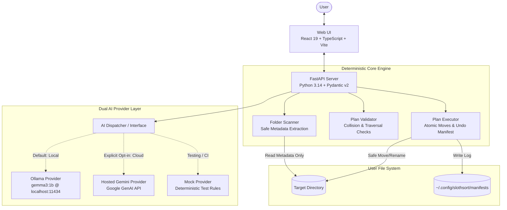

# SlothSort Architecture

> **Tagline:** *"Let your laptop clean up after you."*
> Built for the Hacktoberfest 2026 Week 3 Open-Source AI Challenge: **"Slow and Steady"**.

---

## 1. System Overview

SlothSort is a privacy-first, local-first intelligent file organization system designed to run comfortably on standard laptops (16 GB RAM, integrated graphics) without requiring expensive cloud infrastructure. It operates on an **advisory AI, deterministic engine** model:



### Core Tenet
**AI proposes; deterministic code verifies; the human approves; the engine executes reversibly.**
The language model never possesses file system write or move handles. It receives read-only file metadata and outputs proposed organizational targets. The deterministic engine validates every target against strict security and collision rules before any disk mutation occurs.

---

## 2. Component Boundaries & Responsibilities

The architecture is strictly partitioned into decoupled layers:

### 2.1 Presentation Layer (`frontend/`)
- **Technology:** React 19, TypeScript, Vite, Tailwind CSS, Lucide icons.
- **Role:** Interactive user experience, directory path configuration, batch progress indicators, side-by-side proposed diff table, interactive conflict resolution, and undo history.
- **Guarantees:**
  - Zero direct file system access (all operations route through the authenticated local backend).
  - Explicit privacy disclosure badges showing which provider is active and whether metadata leaves the device.
  - Zero non-functional or decorative fake controls.

### 2.2 Security & Folder Authorization Policy (`backend/app/security.py`)
- **Technology:** Python `Pathlib`, canonical root containment.
- **Role:** Enforces folder authorization boundaries before any scanner or execution logic touches disk.
- **Guarantees:**
  - Whitelists target folders against `SLOTHSORT_ALLOWED_ROOTS` (default: `$HOME` and `/tmp`).
  - Blocks system paths (`/`, `/bin`, `/etc`, `/sys`, `/proc`, etc.).
  - Blocks credential directories (`.ssh`, `.gnupg`, `.aws`, `.docker`, etc.).
  - Rejects raw traversal tokens (`..`), symlink roots, and attempts to target SlothSort internal manifests.

### 2.3 API & Coordination Layer (`backend/app/api/`)
- **Technology:** FastAPI, Uvicorn, Pydantic v2.
- **Role:** Exposes typed REST endpoints for scanning, plan generation, conflict validation, execution, and rollback.
- **Guarantees:**
  - Enforces request validation using Pydantic schemas.
  - CORS bound to local origin (`localhost:5173` / `127.0.0.1:5173`).
  - No background mutations without explicit user approval.

### 2.4 Core Deterministic Engine (`backend/app/engine/`)
- **Modules:**
  - **`scanner.py`**: Scans user-specified directories. Extracts metadata (filename, extension, size, mtime). Safely skips unreadable files, symlinks, and system directories (`.git`, `node_modules`, `.slothsort`).
  - **`validator.py`**: Verifies path containment (`is_relative_to(root)`), detects path traversal attacks (`..`, symlink escapes), checks destination collisions (intra-batch duplicate destinations), and checks existing file overwrites.
  - **`executor.py`**: Performs atomic file operations (`os.replace` / `shutil.move`). Records every operation in an undo manifest. Reverts operations in reverse order upon undo request.
  - **`undo.py`**: Validates manifest containment against root, restores previous file locations, and cleanly removes empty created category subdirectories.
  - **`manifest.py`**: Manages JSON manifest persistence in `~/.config/slothsort/manifests/`.

### 2.5 AI Provider Subsystem & Manager (`backend/app/providers/`, `backend/app/services/`)
- **Modules:**
  - **`base.py`**: Defines the `AIProvider` abstract protocol.
  - **`ollama_provider.py`**: Local HTTP client to Ollama daemon (`localhost:11434`), default model: `gemma3:1b`. Uses native JSON mode and batching (15 files/batch).
  - **`gemini_provider.py`**: Hosted Google Gemini provider (`gemini-2.5-flash`). Reads API key securely from environment/backend config.
  - **`mock_provider.py`**: Predictable heuristic rules for automated testing and CI without dependencies.
  - **`provider_manager.py`**: Manages provider registry, health checks, and explicit routing. Enforces **zero silent fallback** (never switches from local to cloud silently).

### 2.6 CLI Tooling (`backend/app/cli/`)
- **`seed_demo.py`**: Safe CLI demo utility that populates a target directory with 12 harmless dummy files across multiple formats (PDFs, code, media stubs, archives) with collision avoidance and dry-run preview.

---

## 3. Data Schemas & Models

Both backend and frontend share identical domain entities:

### 3.1 File Metadata (`FileMetadata`)
```python
class FileMetadata(BaseModel):
    id: str                          # SHA-256 of relative_path (immutable tracking key)
    original_rel_path: str           # Path relative to scan root (e.g., "receipt_may.pdf")
    filename: str                    # Current filename ("receipt_may.pdf")
    extension: str                   # Extension lowercase without dot ("pdf")
    size_bytes: int                  # File size in bytes
    modified_at: str                 # ISO-8601 timestamp
    is_symlink: bool                 # Flag if file is a symlink
    is_accessible: bool              # Read permissions verified
```

### 3.2 AI Suggestion (`FileSuggestion`)
```python
class FileSuggestion(BaseModel):
    file_id: str                     # Matches FileMetadata.id
    suggested_category: str          # e.g., "Finance/Receipts" or "Documents"
    suggested_filename: str          # e.g., "2026-05_receipt_electric.pdf"
    reasoning: str                   # Human-readable explanation from model
```

### 3.3 Planned Operation (`FileOperation`)
```python
class OperationType(str, Enum):
    MOVE = "MOVE"
    RENAME = "RENAME"
    MOVE_AND_RENAME = "MOVE_AND_RENAME"
    KEEP = "KEEP"

class FileOperation(BaseModel):
    op_id: str                       # Unique operation UUID
    file_id: str                     # Linked FileMetadata.id
    source_rel_path: str             # e.g., "receipt_may.pdf"
    target_rel_path: str             # e.g., "Finance/Receipts/2026-05_receipt_electric.pdf"
    op_type: OperationType           # Calculated operation type
    is_approved: bool                # User approval toggle (default True)
    has_conflict: bool               # Collision or security flag
    conflict_message: Optional[str]  # Human-readable conflict explanation
```

### 3.4 Action Plan (`OrganizationPlan`)
```python
class OrganizationPlan(BaseModel):
    plan_id: str                     # Unique plan UUID
    root_path: str                   # Canonical absolute root path
    created_at: str                  # ISO-8601 timestamp
    provider_used: str               # "ollama:gemma3:1b" or "gemini:gemini-2.5-flash"
    total_files: int
    operations: List[FileOperation]
    conflicts_detected: int
    is_validated: bool
```

### 3.5 Execution Manifest & Undo Log (`UndoManifest`)
```python
class ExecutedStep(BaseModel):
    op_id: str
    source_abs_path: str
    target_abs_path: str
    file_size_bytes: int
    timestamp: str

class UndoManifest(BaseModel):
    manifest_id: str                 # UUID of executed batch
    plan_id: str
    root_path: str
    executed_at: str
    steps: List[ExecutedStep]        # Ordered list of successful moves
    status: str                      # "APPLIED" | "ROLLED_BACK" | "PARTIALLY_ROLLED_BACK"
```

---

## 4. API Endpoints

| Method | Endpoint | Description | Request Payload | Response |
|---|---|---|---|---|
| `GET` | `/api/health` | Backend and runtime health | None | `{ "status": "ok", "ollama": {...}, "gemini": {...} }` |
| `POST` | `/api/scan` | Scans target folder, returns metadata | `{ "root_path": "/home/user/Downloads" }` | `ScanResult` |
| `GET` | `/api/providers` | Lists available AI providers & statuses | None | `List[ProviderStatus]` |
| `POST` | `/api/plan/generate` | Generates suggestions using chosen AI | `{ "root_path": "...", "provider": "ollama", "file_ids": [...] }` | `OrganizationPlan` |
| `POST` | `/api/plan/validate` | Validates manual user edits | `{ "plan_id": "...", "operations": [...] }` | `ValidationResult` |
| `POST` | `/api/plan/execute` | Executes approved operations | `{ "plan_id": "...", "approved_op_ids": [...] }` | `ExecutionResult` |
| `POST` | `/api/undo` | Rolls back an executed batch | `{ "manifest_id": "..." }` | `UndoResult` |
| `GET` | `/api/history` | Lists previous execution manifests | None | `List[UndoManifestSummary]` |

---

## 5. Resource Profile & Performance Budget

Target Hardware: Standard 16 GB RAM laptop, 4-8 CPU cores, integrated GPU (Intel Iris / AMD Radeon).

| Subsystem | RAM Budget | CPU / GPU Budget | Latency Expectation |
|---|---|---|---|
| **FastAPI Backend** | < 80 MB | < 2% idle CPU | < 10ms per API call |
| **Vite / React Frontend** | < 120 MB (browser tab) | Minimal | 60 FPS UI transitions |
| **Ollama (`gemma3:1b`)** | ~806 MB VRAM / RAM | 2-4 CPU threads (if no GPU) | ~300ms - 800ms per 15-file batch |
| **Disk I/O (Scanner)** | < 30 MB | Sequential directory reads | < 500ms for 1,000 files |
| **Disk I/O (Executor)** | Negligible | Local directory renames (same volume) | < 1ms per file (instant rename) |

The total memory consumption of SlothSort and Ollama combined is under **1.2 GB**, leaving over 14.5 GB of system memory for the operating system and user applications.

---

## 6. Directory Structure

```text
slothsort/
├── docs/
│   ├── ARCHITECTURE.md          # This document
│   ├── SAFETY_MODEL.md          # 10 Inviolable Safety Invariants
│   ├── AI_PROVIDER_STRATEGY.md  # Local Ollama + Hosted Gemini specification
│   └── IMPLEMENTATION_PLAN.md   # Phased delivery roadmap and MVP milestones
├── backend/
│   ├── app/
│   │   ├── __init__.py
│   │   ├── main.py              # FastAPI application entrypoint
│   │   ├── config.py            # Environment & application settings
│   │   ├── api/                 # API routers (scan, plan, execute, undo)
│   │   ├── engine/              # Deterministic scanner, validator, executor
│   │   ├── providers/           # Base, Ollama, Gemini, and Mock AI providers
│   │   └── models/              # Pydantic schemas
│   ├── tests/                   # Pytest suite (safety, path traversal, mock providers)
│   ├── pyproject.toml           # Python dependencies and build config
│   └── requirements.txt         # Pinned backend dependencies
├── frontend/
│   ├── src/
│   │   ├── components/          # Folder picker, Diff table, Conflict banner, Mascot
│   │   ├── hooks/               # Provider state, scan hooks, execution state
│   │   ├── types/               # TypeScript interfaces matching backend models
│   │   ├── services/            # Axios / Fetch client wrappers
│   │   ├── App.tsx              # Main application shell
│   │   └── index.css            # Calm forest green design tokens & Tailwind
│   ├── index.html
│   ├── package.json
│   ├── tsconfig.json
│   └── vite.config.ts
└── README.md                    # Project overview, installation, and usage
```
